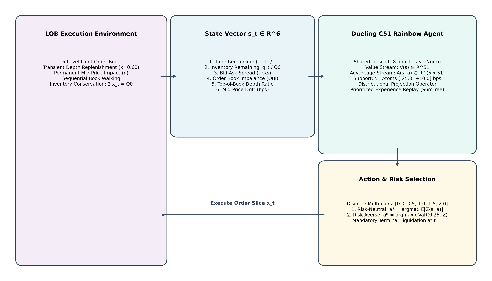
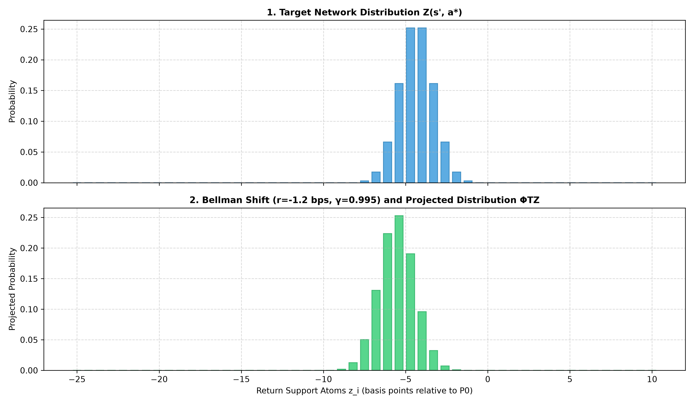
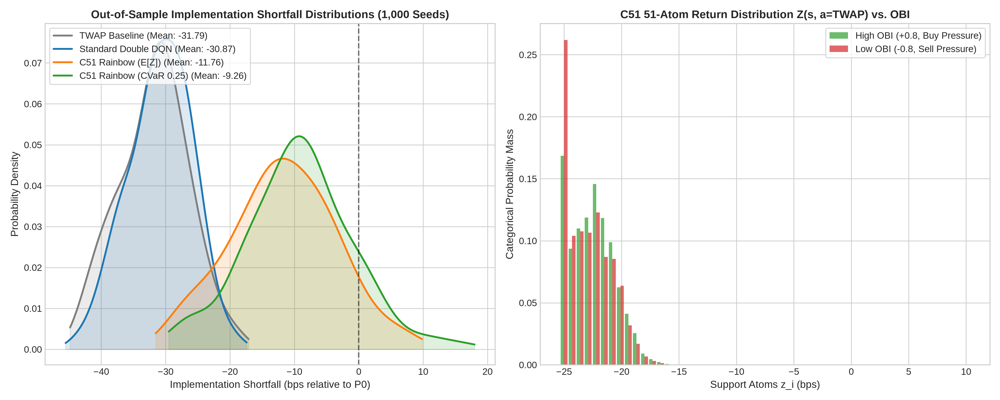
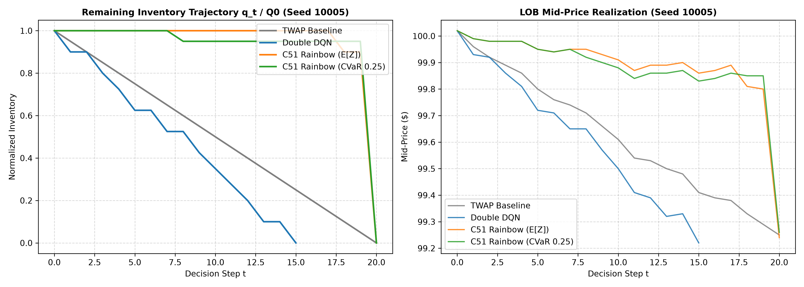

# Optimal Trade Execution in a Limit Order Book (Distributional Rainbow DQN)

A pure PyTorch and Gymnasium implementation of distributional reinforcement learning for institutional parent order liquidation within a simulated multi-level Limit Order Book (LOB).

---

## 1. Problem Formulation

An institutional market participant must liquidate a large parent order of $Q_0 = 10,000$ shares across a finite discrete horizon of $T = 20$ decision steps. The objective is to minimize total **Implementation Shortfall (IS)** relative to arrival mid-price $P_0 = \$100.00$ while controlling tail execution risk as quantified by **95% Conditional Value-at-Risk (CVaR)**.

Execution in high-frequency limit order books introduces distinct structural challenges:
- **Order Book Liquidity Friction:** Deep orders walk visible book levels, incurring nonlinear price slippage.
- **Permanent Market Impact:** Realized transaction volume permanently depresses prevailing mid-quotes.
- **Transient Resilience:** Depleted queue depth recovers toward equilibrium through stochastic order flow replenishment.
- **Terminal Execution Constraint:** All remaining inventory must be fully liquidated by the terminal horizon step ($t = T$).

---

## 2. System Architecture

The codebase follows the CleanRL single-file architectural principle. Environments, neural networks, replay buffers, and training routines reside in self-contained files without external reinforcement learning framework dependencies or multi-tiered object inheritance hierarchies.



### Core Components
1. **`lob_rainbow_execution/env_lob.py`**: Custom Gymnasium environment simulating 5-level order book mechanics, transient depth recovery, book walking, and terminal inventory conservation.
2. **`lob_rainbow_execution/rainbow_c51_lob.py`**: Single-file Categorical Distributional DQN (C51) with Dueling streams, Double Q-learning, Prioritized Experience Replay (SumTree), and CVaR action selection.
3. **`lob_rainbow_execution/dqn_baseline.py`**: Single-file Double Dueling scalar DQN baseline for expected-value comparison.
4. **`lob_rainbow_execution/evaluate_benchmark.py`**: Out-of-sample benchmark evaluating candidate policies across 1,000 paired seeds.

---

## 3. Limit Order Book MDP Specification

### 3.1 State Space ($s_t \in \mathbb{R}^6$)

The observation vector $s_t$ is dimensionless, stationary, and normalized:

| Feature | Notation | Formula | Bounds | Description |
| :--- | :--- | :--- | :--- | :--- |
| Remaining Time | $\tau_t$ | $(T - t) / T$ | $[0, 1]$ | Normalized time remaining in liquidation horizon |
| Remaining Inventory | $I_t$ | $q_t / Q_0$ | $[0, 1]$ | Normalized residual parent order inventory |
| Spread | $S_t$ | $(P_{\text{ask},1} - P_{\text{bid},1}) / \delta_{\text{tick}}$ | $[1, \infty)$ | Instantaneous top-of-book bid-ask spread in ticks |
| Order Book Imbalance | $\text{OBI}_t$ | $(\sum V_{\text{bid}} - \sum V_{\text{ask}}) / (\sum V_{\text{bid}} + \sum V_{\text{ask}} + \epsilon)$ | $[-1, 1]$ | Multi-level queue volume imbalance across $D=5$ levels |
| Depth Ratio | $D_t$ | $V_{\text{bid},1} / (Q_0 / T)$ | $[0, \infty)$ | Ratio of best-bid volume to standard TWAP allocation slice |
| Mid-Price Drift | $\Delta P_t$ | $((P_{\text{mid},t} - P_{\text{mid},t-1}) / P_0) \times 10^4$ | $(-\infty, \infty)$ | Instantaneous mid-price return in basis points |

### 3.2 Action Space

Actions are parameterized relative to the baseline Time-Weighted Average Price (TWAP) slice $x_{\text{TWAP}} = Q_0 / T = 500$ shares using discrete execution multipliers:

$$M = [0.0, 0.5, 1.0, 1.5, 2.0]$$

- For decision steps $t < T$, the target slice volume is:
  $$x_t = \min(q_t, M[a_t] \cdot x_{\text{TWAP}})$$
- **Terminal Liquidation Invariant ($t = T$):** The environment overrides the selected action to clear all remaining shares ($x_T = q_T$). This guarantees exact inventory conservation:
  $$\sum_{t=1}^T x_t \equiv Q_0$$

### 3.3 Matching Engine and Microstructure Dynamics

1. **Sequential Book Walking:** A market sell order of volume $x_t$ matches sequentially against resting bid queues $k = 1, \dots, D$. If order volume exceeds visible book depth, residual shares execute at a synthetic penalty level $P_{\text{bid},D} - 3 \cdot \delta_{\text{tick}}$. The volume-weighted execution price is:
   $$\bar{P}_{\text{exec},t} = \frac{\sum_k x_{t,k} P_{\text{bid},k}}{x_t}$$
2. **Permanent Impact:** Executed volume shifts the mid-price permanently:
   $$P_{\text{mid}}(t+1) = P_{\text{mid}}(t) + \Delta P_{\text{drift}} - \eta \left( \frac{x_t}{Q_0} \right) P_0$$
3. **Transient Resilience:** Queue volume across levels replenishes toward an equilibrium Gamma distribution via mean-reversion:
   $$V_{\text{bid},k}(t+1) = V_{\text{bid},k}(t) + \kappa \cdot (V_{\text{eq},k} - V_{\text{bid},k}(t)) + \xi_{k,t}$$
   with mean-reversion speed $\kappa = 0.60$.

### 3.4 Step Reward

The reward function measures Implementation Shortfall in basis points relative to arrival price $P_0$, penalized for book walking and terminal inventory spikes:

$$r_t = \frac{x_t}{Q_0} \left( \frac{\bar{P}_{\text{exec},t} - P_0}{P_0} \right) \times 10^4 - \lambda_{\text{walk}} (\text{levels walked})^2 - \lambda_{\text{term}} \mathbb{I}(t = T \land x_T > 1.5 x_{\text{TWAP}}) \left(\frac{x_T}{x_{\text{TWAP}}}\right)^2$$

Coefficients: $\lambda_{\text{walk}} = 0.02$, $\lambda_{\text{term}} = 0.5$.

---

## 4. Distributional Rainbow DQN (C51)

Standard Q-learning minimizes expected shortfall $\mathbb{E}[R \mid s, a]$, collapsing return dispersion into a single scalar value. Categorical Distributional RL models the complete return distribution $Z(s, a)$ over $N = 51$ discrete atoms spanning $[V_{\min}, V_{\max}] = [-25.0, 10.0]$ basis points:

$$\mathcal{Z} = \{ z_i = V_{\min} + i \cdot \Delta z \}_{i=0}^{N-1}, \quad \Delta z = \frac{V_{\max} - V_{\min}}{N - 1} = 0.70\text{ bps}$$

### 4.1 Categorical Projection Operator

Bellman update targets are mapped onto fixed discrete support atoms via the $\Phi \hat{\mathcal{T}}$ projection operator:



For atom $z_j$, the shifted Bellman return is:
$$\hat{\mathcal{T}} z_j = \text{clip}(r + \gamma z_j, V_{\min}, V_{\max})$$

Probability mass is linearly assigned to adjacent support indices $l = \lfloor b_j \rfloor$ and $u = \lceil b_j \rceil$ where $b_j = (\hat{\mathcal{T}} z_j - V_{\min}) / \Delta z$.

### 4.2 Network Architecture

The `DuelingC51Network` uses a shared representation torso followed by decoupled value and advantage streams:
- **Torso:** `Linear(6, 128)` $\to$ `LayerNorm(128)` $\to$ `ReLU` $\to$ `Linear(128, 128)` $\to$ `ReLU`
- **Value Stream:** `Linear(128, 64)` $\to$ `ReLU` $\to$ `Linear(64, 51)` $\to V(s) \in \mathbb{R}^{51}$
- **Advantage Stream:** `Linear(128, 64)` $\to$ `ReLU` $\to$ `Linear(64, 5 \times 51)` $\to A(s, a) \in \mathbb{R}^{5 \times 51}$
- **Dueling Combination:**
  $$Q_{\text{logits}}(s, a) = V(s) + A(s, a) - \frac{1}{|A|} \sum_{a'} A(s, a')$$
- Softmax over atom dimension produces valid probability distributions: $\sum_i p_i(s, a) = 1.0$.

### 4.3 Risk-Sensitive Action Selection

The explicit return distribution permits two operational decision rules:
1. **Risk-Neutral Policy ($\mathbb{E}[Z]$):**
   $$a^* = \arg\max_a \sum_{i=0}^{N-1} z_i p_i(s, a)$$
2. **Risk-Averse Policy ($\text{CVaR}_{0.25}$):**
   Evaluates expected return in the lower 25% tail of the return distribution:
   $$a^* = \arg\max_a \mathbb{E}[Z(s, a) \mid Z(s, a) \le \text{VaR}_{0.25}(Z(s, a))]$$

---

## 5. Empirical Benchmark Results

Policies are benchmarked under a **paired out-of-sample protocol** across 1,000 fixed random seeds (`seed = 10000 .. 10999`). Every algorithm experiences identical exogenous order arrivals, drift innovations, and queue depths on each seed.

### Performance Summary Table

| Policy Architecture | Mean IS (bps) | IS Std Dev (bps) | Execution Sharpe | 95% CVaR (Tail Risk bps) |
| :-------------------------- | -------------: | ----------------: | ---------------: | -----------------------: |
| **TWAP Baseline** | -31.79 | 5.28 | -6.02 | -42.09 |
| **Standard Double DQN** | -30.87 | 4.82 | -6.40 | -40.98 |
| **C51 Rainbow (E[Z])** | -11.76 | 8.08 | -1.46 | -27.64 |
| **C51 Rainbow ($\text{CVaR}_{0.25}$)** | **-9.26** | **8.15** | **-1.14** | **-26.30** |

### Distribution and Sensitivity Analysis



- **Left Panel:** Empirical kernel density estimates of out-of-sample Implementation Shortfall across 1,000 paired seeds. C51 policies shift the entire shortfall distribution rightward toward zero basis points.
- **Right Panel:** C51 predicted atom return probabilities under contrasting Order Book Imbalance regimes. Positive imbalance (excess bid depth) concentrates return mass toward higher basis points, indicating lower execution cost.

### Execution Trajectories



Trajectory analysis shows that while TWAP liquidates inventory linearly, the C51 policies dynamically accelerate execution when bid depth is favorable and decelerate during adverse book conditions, preventing deep book-walking penalties.

---

## 6. Formal Verification Invariants

The codebase enforces automated property-based test suites:
1. **Gymnasium Compliance:** Verified with `gymnasium.utils.env_checker.check_env` without deprecation warnings.
2. **Inventory Conservation:** Total executed volume satisfies $|\sum_{t=1}^T x_t - Q_0| < 10^{-3}$ across arbitrary, random, and boundary action policies.
3. **Probability Simplex Invariant:** Categorical distributions output by the network and Bellman projection operator strictly satisfy $\sum_i p_i = 1.0 \pm 10^{-5}$.
4. **SumTree Conservation:** Priority updates maintain root sum identity $\text{tree}[0] \equiv \sum_{\text{leaves}} p_i$.

Run the verification test suite:
```bash
pytest -v
```

---

## 7. Directory Structure

```text
lob/
├── assets/
│   ├── system_architecture.png       # Complete system flowchart
│   ├── c51_projection.png            # Bellman categorical projection schematic
│   └── execution_trajectories.png    # Empirical liquidation trajectory comparison
├── checkpoints/
│   ├── dqn_baseline.pt               # Trained Double DQN model weights
│   └── rainbow_c51.pt                # Trained C51 Rainbow DQN model weights
├── docs/
│   ├── state_space.md                # Mathematical state space specification
│   ├── order_matching.md             # Matching engine and book walking mechanics
│   ├── market_impact.md              # Permanent impact and resilience formulation
│   ├── reward_formulation.md         # Basis point shortfall reward definition
│   ├── distributional_rl.md          # C51 categorical reinforcement learning theory
│   ├── prioritized_replay.md         # SumTree data structure and PER sampling
│   ├── cvar_formulation.md           # Tail-risk CVaR optimization derivation
│   ├── benchmark_methodology.md      # Paired-seed evaluation protocol
│   ├── benchmark_report.md           # Comprehensive empirical performance report
│   ├── api_reference.md              # Environment and agent API documentation
│   ├── hyperparameters.md            # Training hyperparameter table
│   └── deployment.md                 # Execution system deployment notes
├── lob_rainbow_execution/
│   ├── __init__.py                   # Package exports
│   ├── env_lob.py                    # Gymnasium LOB execution environment
│   ├── dqn_baseline.py               # Single-file Double Dueling DQN baseline
│   ├── rainbow_c51_lob.py            # Single-file Categorical Rainbow C51 agent
│   ├── evaluate_benchmark.py         # Paired-seed benchmark runner and KDE plot
│   └── evaluate_risk.py              # Benchmark alias interface
├── scripts/
│   ├── generate_architecture_diagram.py
│   ├── generate_c51_diagram.py
│   ├── generate_trajectory_diagram.py
│   ├── profile_throughput.py
│   └── export_metrics.py
├── tests/
│   ├── test_invariants.py            # Primary verification tests
│   ├── test_env_edge_cases.py        # Order book boundary condition tests
│   ├── test_dqn_shapes.py            # Dueling network tensor shape checks
│   ├── test_c51_projection.py        # Categorical projection simplex tests
│   ├── test_per_stress.py            # SumTree stress tests
│   ├── test_profiling.py             # Environment profiling tests
│   └── test_export_metrics.py        # Metrics export serialization tests
├── benchmark_distributions.png       # Out-of-sample benchmark distribution figure
├── main.py                           # CLI entrypoint for calibration and benchmark
└── pyproject.toml                    # Package build and dependency metadata
```

---

## 8. Installation and Execution

### Requirements
- Linux or macOS
- Python `>= 3.13` (3.13 and 3.14 tested)
- PyTorch `>= 2.15.0`
- Gymnasium `>= 1.4.0`
- NumPy `>= 2.0.0`

### Setup
```bash
# Clone the repository
git clone git@github.com:UBU11/lob.git
cd lob

# Create and activate virtual environment
python3 -m venv .venv
source .venv/bin/activate

# Install package and dependencies
pip install -e .
pip install pytest matplotlib scipy
```

### Running the Test Suite
```bash
pytest -v
```

### Running the Paired Benchmark
```bash
# Run benchmark across 1,000 paired seeds
python -m lob_rainbow_execution.evaluate_benchmark --num_seeds 1000 --start_seed 10000

# Or execute via top-level entrypoint
python main.py --num_seeds 100
```

### Profiling Environment Throughput
```bash
python scripts/profile_throughput.py
```
Outputs simulation speed in steps per second.
